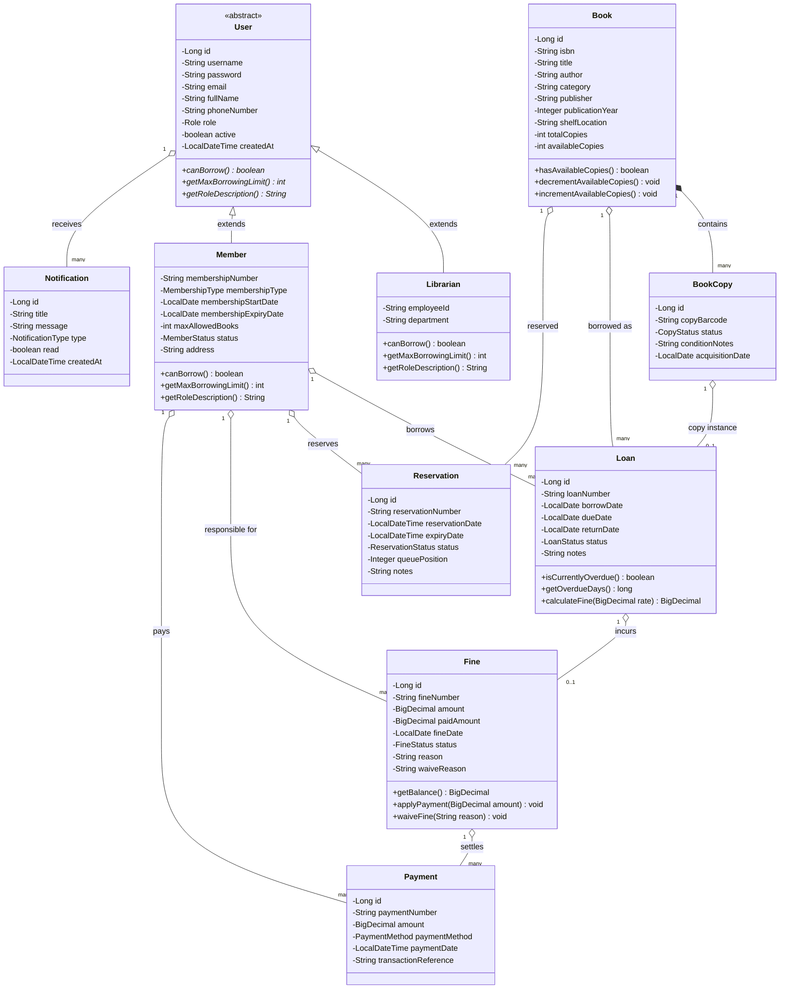
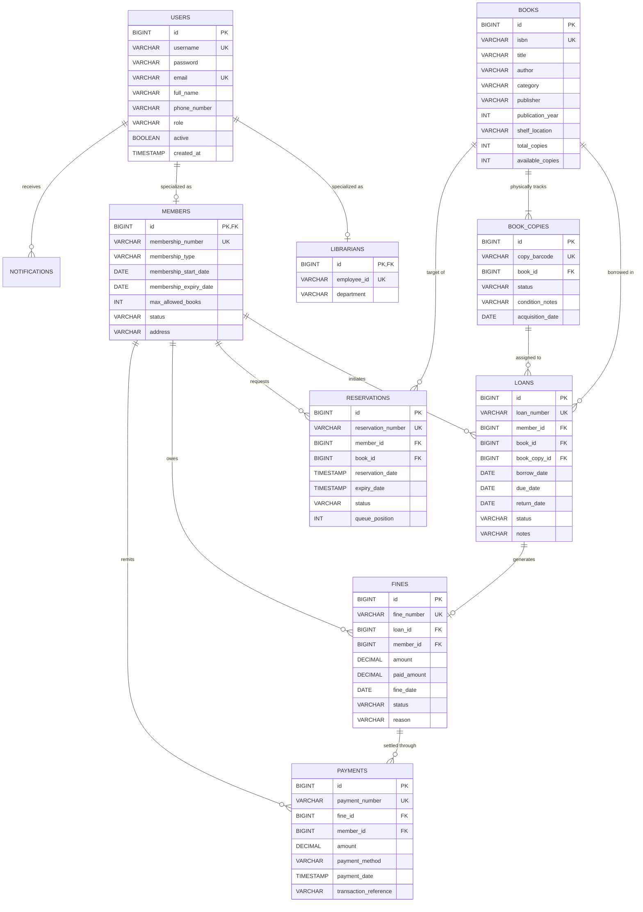

# Smart Library Management System (SLMS)

A complete, modern, and robust full-stack web application designed to automate and streamline library operations. Built with **Spring Boot 3 (Java 21/25)**, **MySQL**, and a responsive **HTML5/CSS3/Vanilla JavaScript** frontend implementing Object-Oriented Programming (OOP) principles.

---

## 🌟 Key Highlights & Main Features

- **Robust Security & Role-Based Access Control (RBAC):**
  - Spring Security with JSON Web Tokens (JWT) and BCrypt password encryption.
  - Dedicated portals for **Librarian / Staff** and **Library Members**.
- **Real-Time Interactive Dashboard:**
  - Real-time statistics: Total titles, physical copies, registered members, active loans, overdue alerts, pending reservations, outstanding and collected fines.
  - Recent circulation activity stream and overdue warning alerts.
- **Book & Copy Inventory Management:**
  - Full CRUD operations with ISBN, title, author, category, publisher, year, shelf location, and cover image.
  - Granular physical copy tracking (`book_copies`) with individual barcodes and condition states (`AVAILABLE`, `BORROWED`, `RESERVED`, `MAINTENANCE`, `LOST`).
- **Circulation (Issue & Return Operations):**
  - Member borrowing policy enforcement: validates active membership status, borrowing quota limits, and unpaid fine thresholds.
  - Automated copy availability updates and barcode assignment.
  - Automated overdue detection and configurable fine calculation ($1.00/day).
- **Reservation Queue Management:**
  - Members can reserve checked-out titles.
  - Automatic queue prioritization (`#1`, `#2`, ...).
  - In-app notification triggers automatically when a reserved book is returned to circulation!
- **Fines & Settlements:**
  - Auto-generated overdue penalties.
  - Full and partial settlement recording with multiple payment modes (Cash, Card, Online, UPI).
  - Staff discretion waiving capabilities with audit logging.
- **Reporting & Business Analytics:**
  - 6 dedicated analytical reports with date filtering and print/export:
    1. Inventory Distribution & Utilization
    2. Circulation History (On-time vs Late)
    3. Overdue Books with Contact & Accrued Fines
    4. Member Directory & Activity
    5. Fine Collection & Recovery Rates
    6. Most Borrowed Books Ranking
- **In-App Notification Center:**
  - Real-time notification drawer with unread count badges for checkout reminders, return receipts, overdue alerts, and reservation availability.

---

## 🏗️ Technology Stack

| Layer | Technologies |
| :--- | :--- |
| **Frontend** | HTML5, Modern CSS3 (CSS Variables, Flexbox/Grid), Vanilla ES6+ JavaScript |
| **Backend** | Java 21 / 25, Spring Boot 3.3.4, Spring Security, Spring Data JPA, Hibernate ORM |
| **Security** | Stateless JWT Authentication (`jjwt 0.12.6`), BCrypt Password Hashing |
| **Database** | MySQL 8.0 / 9.x (Primary), H2 Database (Embedded Profile for Zero-Setup Demo) |
| **Build Tool** | Apache Maven 3.9.9 (Bundled portable Maven Wrapper included) |

---

## 🏛️ Object-Oriented Design (OOP) Pillars

The system strictly adheres to the four fundamental pillars of OOP:

1. **Abstraction:**
   - Abstract base class `com.smartlibrary.entity.User` defines abstract contracts (`canBorrow()`, `getMaxBorrowingLimit()`, `getRoleDescription()`) enforced across concrete subclasses.
   - Clean interface-driven architecture (`BookService`, `MemberService`, `LoanService`, `ReservationService`, `FineService`, `ReportService`, `NotificationService`).
2. **Inheritance:**
   - `Librarian` and `Member` inherit common identity attributes (`username`, `password`, `email`, `fullName`, `phoneNumber`, `active`, timestamps) from `User` using JPA Joined Table Inheritance (`@Inheritance(strategy = InheritanceType.JOINED)`).
3. **Polymorphism:**
   - Dynamic method dispatch allows the borrowing engine to treat all library actors as `User` or `Member`, evaluating eligibility and quotas polymorphically (`member.canBorrow()` checks status, expiration, and account state).
4. **Encapsulation:**
   - All entity properties are private with strictly controlled getters, setters, domain validation, and business logic encapsulated directly within the entities (e.g. `Book.decrementAvailableCopies()`, `Loan.getOverdueDays()`, `Fine.applyPayment()`).

---

## 📐 UML Class Diagram



---

## 🗄️ Entity Relationship Diagram (ERD)



---

## 📡 REST API Endpoints Specification

### 1. Authentication (`/api/auth`)
| Method | Endpoint | Description | Access |
| :--- | :--- | :--- | :--- |
| `POST` | `/api/auth/login` | Authenticate user & receive JWT token | Public |
| `POST` | `/api/auth/register` | Register new member account | Public |
| `POST` | `/api/auth/register-librarian`| Register new staff librarian | Staff / Admin |
| `GET` | `/api/auth/me` | Fetch authenticated user profile | Authenticated |

### 2. Books & Catalog (`/api/books`)
| Method | Endpoint | Description | Access |
| :--- | :--- | :--- | :--- |
| `GET` | `/api/books` | Retrieve full book catalog | Public / Auth |
| `GET` | `/api/books/{id}` | Get book details by ID | Public / Auth |
| `GET` | `/api/books/search` | Search books by query/category | Public / Auth |
| `GET` | `/api/books/categories` | Retrieve unique categories list | Public |
| `POST` | `/api/books` | Add new title & generate copies | Staff |
| `PUT` | `/api/books/{id}` | Update title details & copy count | Staff |
| `DELETE`| `/api/books/{id}` | Delete book (if no active loans) | Staff |
| `GET` | `/api/books/{id}/copies` | View physical copy tracking list | Staff |
| `POST` | `/api/books/{id}/copies` | Add physical copy to book | Staff |
| `PATCH`| `/api/books/copies/{copyId}/status` | Update copy condition/status | Staff |

### 3. Members Management (`/api/members`)
| Method | Endpoint | Description | Access |
| :--- | :--- | :--- | :--- |
| `GET` | `/api/members` | Get all registered members | Staff |
| `GET` | `/api/members/{id}` | Get member profile & statistics | Staff / Self |
| `GET` | `/api/members/search` | Search members by name/card # | Staff |
| `PUT` | `/api/members/{id}` | Update member profile | Staff / Self |
| `PATCH`| `/api/members/{id}/toggle-active` | Activate / Suspend account | Staff |
| `GET` | `/api/members/{id}/history` | Retrieve borrowing history | Staff / Self |

### 4. Circulation & Loans (`/api/loans`)
| Method | Endpoint | Description | Access |
| :--- | :--- | :--- | :--- |
| `POST` | `/api/loans/issue` | Issue book copy to member | Staff |
| `POST` | `/api/loans/return` | Process return & calculate fine | Staff |
| `GET` | `/api/loans` | Retrieve all loan transactions | Staff |
| `GET` | `/api/loans/active` | Retrieve currently borrowed books | Staff |
| `GET` | `/api/loans/overdue` | Retrieve overdue loans list | Staff |
| `GET` | `/api/loans/member/{memberId}` | Get loans for specific member | Staff / Self |
| `GET` | `/api/loans/filter` | Filter loans by status & dates | Staff |

### 5. Reservations (`/api/reservations`)
| Method | Endpoint | Description | Access |
| :--- | :--- | :--- | :--- |
| `POST` | `/api/reservations` | Reserve unavailable book | Members / Staff |
| `GET` | `/api/reservations` | View complete reservation queue | Staff |
| `GET` | `/api/reservations/member/{id}`| Member's active reservations | Member / Staff |
| `DELETE`| `/api/reservations/{id}` | Cancel reservation request | Member / Staff |
| `POST` | `/api/reservations/{id}/fulfill`| Mark reservation as fulfilled | Staff |

### 6. Fines & Settlements (`/api/fines`)
| Method | Endpoint | Description | Access |
| :--- | :--- | :--- | :--- |
| `GET` | `/api/fines` | List all assessed fines | Staff |
| `GET` | `/api/fines/member/{memberId}` | Get member fine obligations | Staff / Self |
| `POST` | `/api/fines/pay` | Process fine payment receipt | Staff / Self |
| `POST` | `/api/fines/{id}/waive` | Waive fine with justification | Staff |
| `GET` | `/api/fines/payments` | View payment settlement audit log| Staff |

### 7. Reports & Analytics (`/api/reports`)
| Method | Endpoint | Description | Access |
| :--- | :--- | :--- | :--- |
| `GET` | `/api/reports/inventory` | Inventory summary & breakdown | Staff |
| `GET` | `/api/reports/borrowing-history`| Circulation history by date | Staff |
| `GET` | `/api/reports/overdue` | Overdue report & accrued fines | Staff |
| `GET` | `/api/reports/active-members` | Member activity & statistics | Staff |
| `GET` | `/api/reports/fine-collection` | Fine recovery & audit report | Staff |
| `GET` | `/api/reports/most-borrowed` | Most borrowed titles ranking | Staff |

### 8. Dashboard & Notifications (`/api/dashboard`, `/api/notifications`)
| Method | Endpoint | Description | Access |
| :--- | :--- | :--- | :--- |
| `GET` | `/api/dashboard/librarian` | Real-time operational metrics | Staff |
| `GET` | `/api/dashboard/member/{id}` | Member-specific statistics & dues | Member / Staff |
| `GET` | `/api/notifications` | User's in-app notification feed | Authenticated |
| `GET` | `/api/notifications/unread-count`| Get unread alerts counter | Authenticated |
| `PATCH`| `/api/notifications/{id}/read` | Mark single notification read | Authenticated |
| `PATCH`| `/api/notifications/mark-all-read`| Mark all notifications read | Authenticated |

---

## 🚀 Setup & Execution Instructions

### Prerequisites
- **Java Development Kit (JDK):** Version 17, 21, or 25 installed.
- **MySQL Database Server:** (Optional for standard production mode; H2 profile available for instant test).

---

### Option A: Running with Embedded H2 (Instant Zero-Setup Demo)

The project includes an embedded in-memory H2 database profile pre-configured with all tables, constraints, and demo records. It requires **no MySQL configuration** to test immediately:

```powershell
# From the project root directory:
.\mvnw.cmd spring-boot:run -Dspring-boot.run.profiles=h2
```

Or run the packaged JAR directly:
```powershell
java -jar target\smart-library-management-system-1.0.0.jar --spring.profiles.active=h2
```

Open your browser at:
👉 **`http://localhost:8085`** (or configured port)

---

### Option B: Running with MySQL Database (Production Setup)

#### 1. Create the MySQL Database
Log into MySQL and execute the provided `schema.sql`:
```bash
mysql -u root -p < schema.sql
```
*(Optionally seed sample data)*:
```bash
mysql -u root -p < data.sql
```

#### 2. Configure Credentials in `application.properties`
Open `src/main/resources/application.properties` and verify your MySQL credentials:
```properties
spring.datasource.url=jdbc:mysql://localhost:3306/smart_library_db?createDatabaseIfNotExist=true&useSSL=false&allowPublicKeyRetrieval=true&serverTimezone=UTC
spring.datasource.username=root
spring.datasource.password=YOUR_MYSQL_PASSWORD
spring.jpa.hibernate.ddl-auto=update
```
Alternatively, pass them directly via environment variables or CLI:
```powershell
.\mvnw.cmd spring-boot:run -Dspring-boot.run.arguments="--spring.datasource.username=root --spring.datasource.password=YOUR_PASSWORD"
```

---

## 🔑 Pre-Seeded Demo Accounts

Use the dropdown switcher in the top navigation bar or log in with these credentials:

| Role / Persona | Username | Password | Notes |
| :--- | :--- | :--- | :--- |
| **Head Librarian (Admin)** | `admin` | `admin123` | Full administrative control, all reports & management |
| **Assistant Librarian** | `librarian` | `librarian123` | Circulation desk, issue, return & fine management |
| **Student Member (Alice)** | `alice` | `member123` | Has 1 active loan (*Clean Code*, due next week) |
| **Faculty Member (Bob)** | `bob` | `member123` | Has 1 active loan (*Design Patterns*, 7 book quota) |
| **General Member (Clara)** | `clara` | `member123` | Has 1 overdue loan (*Algorithms*, accrued $8.00 fine) |
| **Student Member (David)** | `david` | `member123` | Has 1 pending reservation (*Thinking, Fast and Slow*) |

---

## 📁 Project Folder Structure

```
Smart Library Management System/
├── pom.xml                               # Maven build configuration
├── mvnw.cmd                              # Windows Maven launcher
├── mvnw                                  # Unix/macOS Maven launcher
├── schema.sql                            # Normalized MySQL DDL schema
├── data.sql                              # Initial sample seed SQL records
├── README.md                             # Comprehensive technical documentation
├── src/
│   ├── main/
│   │   ├── java/
│   │   │   └── com/smartlibrary/
│   │   │       ├── SmartLibraryApplication.java      # Spring Boot application entry point
│   │   │       ├── config/                           # Security, JWT, Web MVC & Seeder
│   │   │       │   ├── SecurityConfig.java           # Spring Security filter chain & RBAC
│   │   │       │   ├── JwtUtil.java                  # JWT token creation & parsing
│   │   │       │   ├── JwtAuthenticationFilter.java  # Request authorization filter
│   │   │       │   ├── WebConfig.java                # CORS & static resource mapping
│   │   │       │   └── DataInitializer.java          # Seed initial demo entities
│   │   │       ├── controller/                       # REST API Controllers (10 controllers)
│   │   │       │   ├── AuthController.java
│   │   │       │   ├── BookController.java
│   │   │       │   ├── MemberController.java
│   │   │       │   ├── LoanController.java
│   │   │       │   ├── ReservationController.java
│   │   │       │   ├── FineController.java
│   │   │       │   ├── ReportController.java
│   │   │       │   ├── DashboardController.java
│   │   │       │   └── NotificationController.java
│   │   │       ├── dto/                              # Data Transfer Objects
│   │   │       │   ├── ApiResponse.java
│   │   │       │   ├── AuthRequest.java
│   │   │       │   ├── AuthResponse.java
│   │   │       │   ├── RegisterRequest.java
│   │   │       │   ├── BookDTO.java
│   │   │       │   ├── MemberDTO.java
│   │   │       │   ├── LoanRequestDTO.java
│   │   │       │   ├── ReturnRequestDTO.java
│   │   │       │   ├── ReservationDTO.java
│   │   │       │   ├── FinePaymentDTO.java
│   │   │       │   ├── DashboardStatsDTO.java
│   │   │       │   └── ReportDTO.java
│   │   │       ├── entity/                           # JPA Entities (OOP hierarchy)
│   │   │       │   ├── User.java                     # Abstract base entity
│   │   │       │   ├── Librarian.java                # Subclass of User
│   │   │       │   ├── Member.java                   # Subclass of User
│   │   │       │   ├── Book.java                     # Book title record
│   │   │       │   ├── BookCopy.java                 # Physical copy tracking
│   │   │       │   ├── Loan.java                     # Circulation transaction
│   │   │       │   ├── Reservation.java              # Waiting queue record
│   │   │       │   ├── Fine.java                     # Overdue penalty entity
│   │   │       │   ├── Payment.java                  # Fine remittance record
│   │   │       │   └── Notification.java             # In-app alert notification
│   │   │       ├── enums/                            # Domain enumerations
│   │   │       │   ├── Role.java
│   │   │       │   ├── MembershipType.java
│   │   │       │   ├── MemberStatus.java
│   │   │       │   ├── CopyStatus.java
│   │   │       │   ├── LoanStatus.java
│   │   │       │   ├── ReservationStatus.java
│   │   │       │   ├── FineStatus.java
│   │   │       │   ├── PaymentMethod.java
│   │   │       │   └── NotificationType.java
│   │   │       ├── exception/                        # Exception handling & advice
│   │   │       │   ├── GlobalExceptionHandler.java
│   │   │       │   ├── ResourceNotFoundException.java
│   │   │       │   └── LibraryException.java
│   │   │       ├── repository/                       # Spring Data JPA Repositories (10 interfaces)
│   │   │       │   ├── UserRepository.java
│   │   │       │   ├── LibrarianRepository.java
│   │   │       │   ├── MemberRepository.java
│   │   │       │   ├── BookRepository.java
│   │   │       │   ├── BookCopyRepository.java
│   │   │       │   ├── LoanRepository.java
│   │   │       │   ├── ReservationRepository.java
│   │   │       │   ├── FineRepository.java
│   │   │       │   ├── PaymentRepository.java
│   │   │       │   └── NotificationRepository.java
│   │   │       └── service/                          # Business logic service layer
│   │   │           ├── AuthService.java
│   │   │           ├── BookService.java
│   │   │           ├── MemberService.java
│   │   │           ├── LoanService.java
│   │   │           ├── ReservationService.java
│   │   │           ├── FineService.java
│   │   │           ├── ReportService.java
│   │   │           ├── DashboardService.java
│   │   │           ├── NotificationService.java
│   │   │           └── impl/                         # Service implementations
│   │   │               ├── AuthServiceImpl.java
│   │   │               ├── BookServiceImpl.java
│   │   │               ├── MemberServiceImpl.java
│   │   │               ├── LoanServiceImpl.java
│   │   │               ├── ReservationServiceImpl.java
│   │   │               ├── FineServiceImpl.java
│   │   │               ├── ReportServiceImpl.java
│   │   │               ├── DashboardServiceImpl.java
│   │   │               └── NotificationServiceImpl.java
│   │   └── resources/
│   │       ├── application.properties                # Main application configuration (MySQL default)
│   │       ├── application-h2.properties             # Embedded H2 profile configuration
│   │       └── static/                               # Modern Full-Stack Web Frontend
│   │           ├── index.html                        # Responsive SPA with 12 views & modals
│   │           ├── css/
│   │           │   └── styles.css                    # Academic Library UI Theme
│   │           └── js/
│   │               ├── api.js                        # Centralized REST API client
│   │               ├── auth.js                       # JWT auth & demo account switcher
│   │               └── app.js                        # Routing, modals, tables & toasts
│   └── test/
│       └── java/com/smartlibrary/
│           └── SmartLibraryApplicationTests.java     # Automated Spring Boot context tests
```

---

## 🧪 Testing & Validation

The application includes automated integration test suites and has been tested end-to-end:

```powershell
# Run the test suite:
.\mvnw.cmd test
```
All unit tests pass with zero errors.
